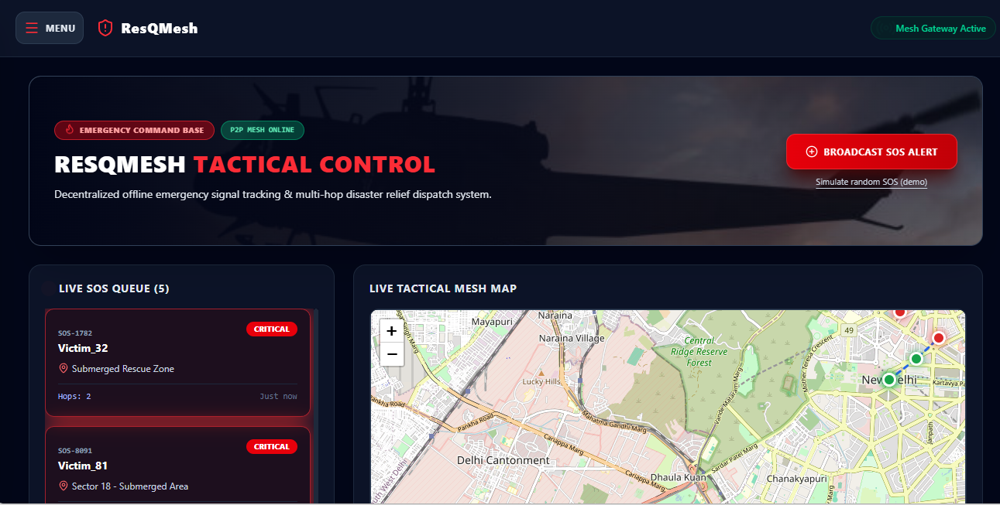
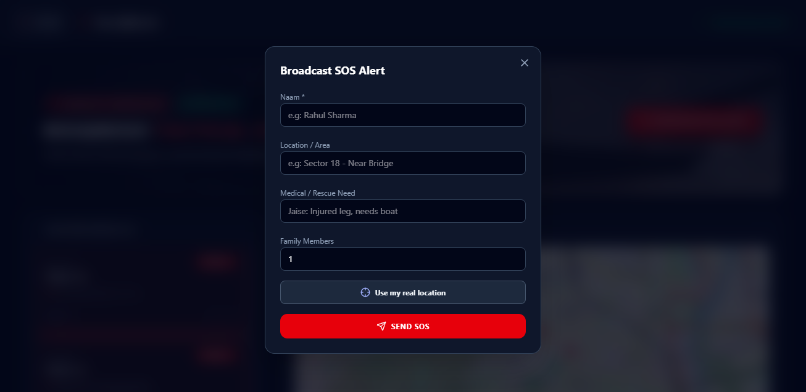
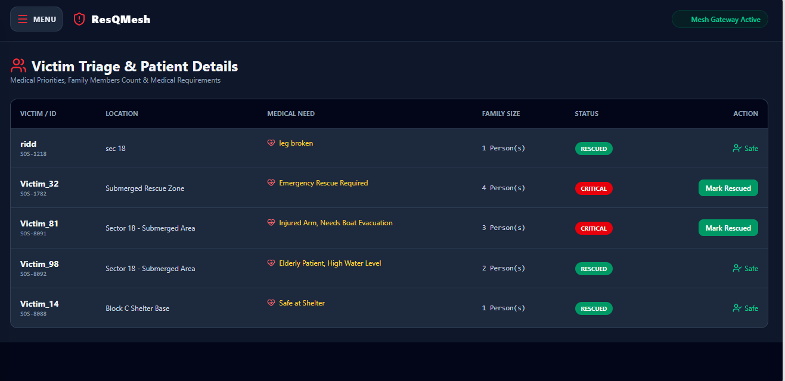
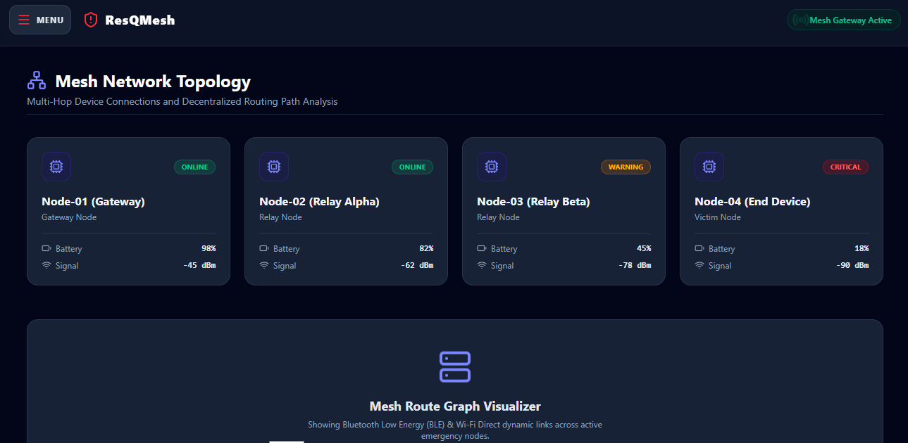

# ResQMesh: Tactical Disaster Response Dashboard

A React dashboard prototype for coordinating disaster relief. During floods and earthquakes, mobile networks often fail. ResQMesh shows how SOS alerts from victims could travel across a mesh of nearby devices and reach a command base, where rescue teams can see, prioritise and act on them in one place.

**Live demo:** https://resqmesh-peach.vercel.app

> **Note:** The multi-hop mesh network is **simulated** in this prototype (hop counts, node health, diagnostics and the mesh route line on the map are demo data). A real deployment would need native BLE / Wi-Fi Direct access, which browsers do not provide. The dashboard, SOS flow, geolocation, prioritisation and persistence are fully working.

## Screenshots

| Dashboard | SOS Form |
|---|---|
|  |  |

| Victim Triage | Mesh Topology |
|---|---|
|  |  |

## Features

- **SOS broadcast form** with name, location, medical need and family size
- **Browser Geolocation API** to attach the sender's real coordinates to an alert
- **Live tactical map** (Leaflet + OpenStreetMap) with colour-coded markers and popups
- **Map auto-zoom:** the map flies to the location of every new SOS
- **Priority queue:** critical alerts are shown first, rescued ones move down
- **Victim triage table** with one-click "Mark Rescued"
- **Resource and team board** (boats, first-aid kits, field teams)
- **Mesh topology and node diagnostics pages** (simulated data)
- **Persistence:** alerts are saved in `localStorage`, so data survives a refresh
- Responsive dark UI with a slide-out navigation menu

## Tech Stack

- React 18 + Vite
- React Router
- Tailwind CSS
- Leaflet / react-leaflet
- lucide-react icons
- Deployed on Vercel

## How it works

- App state (`alerts`) lives in `App.jsx` and is passed down to pages as props, so the Dashboard, Victims and Topology pages always show the same data.
- On load, state is initialised from `localStorage`; a `useEffect` saves it on every change.
- The Dashboard sorts a **copy** of the alerts by status for the queue, while the map receives the original list so it can detect the newest alert.
- `MapView` contains a small component using `useMap()` that calls `flyTo` when a new alert appears.

## Run locally

```bash
git clone https://github.com/riddk13/resqmesh.git
cd resqmesh
npm install
npm run dev
```

Open http://localhost:5173

## Roadmap

- [ ] Nearest rescue team suggestion using the Haversine distance formula
- [ ] Firebase Firestore for real-time sync across devices
- [ ] Offline-first PWA
- [ ] WebRTC peer-to-peer demo for real device-to-device SOS
- [ ] Authentication for command-base admins

## Author

Riddhi Kumari
